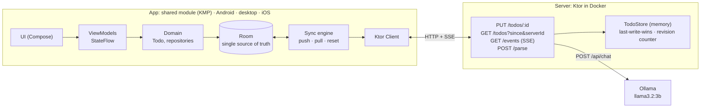

# Todos

**Offline-first tasks for care teams: instant local writes, background sync, live updates
between devices, and voice turned into a draft that a human approves.**

[](https://github.com/rogalz/Todos/actions/workflows/ci.yml?query=branch%3Adevelop)

Kotlin Multiplatform app (Android, desktop, iOS) with a small Ktor backend running in Docker and
a local LLM (Ollama) for voice drafts. Built in a few days as a deliberate exercise in the
problems a care-team product faces: patchy Wi-Fi, several people on the same records, and AI that
must never write into the record on its own.

---

## Features

- **Works without a network.** Every change is saved to the local database first and shown
  immediately; syncing happens in the background.
- **Always visible sync state.** A status chip (`Synced` / `Syncing…` / `Offline · N waiting`) and
  a small icon on every task that hasn't reached the server yet.
- **Live updates.** A change on one device appears on the others in about a second, no refresh.
- **Predictable conflicts.** Last write wins, the same rule on client and server. Deletes are
  tombstones, so other devices learn about them too.
- **Survives a server restart.** The server keeps data in memory; after a restart the clients
  notice (new `serverId`) and push everything back.
- **Voice → draft.** Speak a sentence (Android) or type one (desktop / iOS); a local LLM turns it
  into a title and description. The draft is stored **only** when you tap Save; going back asks
  "Discard draft?". Without the AI your own words become the title.
- **Warm light and dark theme** with WCAG AA contrast, animated list and checkbox, and a
  shared-element transition when opening a task.

## Architecture



**Room is the single source of truth.** The UI only ever reads from the database; the network runs in
the background and only feeds it.

- **Write path:** save → Room (`PENDING`, new `updatedAt`) → UI updates from the Room `Flow` →
  the scheduler sees pending rows and, after a 500 ms debounce, syncs: push (`PUT`), pull
  (`GET ?since`), apply server versions with last-write-wins.
- **Live path:** the server publishes a "changed" signal over SSE; clients react by pulling.
  Events carry no data, so a missed event loses nothing.
- **Voice path:** speech-to-text on the device → `POST /parse` → Ollama returns JSON matching a
  schema → the draft pre-fills a new task → Save stores it through the normal write path.

### Key decisions

| Decision | Why | Rejected alternative |
| --- | --- | --- |
| Client-generated UUIDs | Tasks can be created offline | Server ids need a connection |
| Soft delete (`deletedAt`) | Deletions reach other devices | Hard delete loses that information |
| `markSynced(id, expectedUpdatedAt)` | An edit made during a push is not marked as synced | Unconditional marking silently drops the edit |
| Server revision counter as the pull cursor | Device clocks drift; a counter skips nothing | Timestamp cursors |
| `serverId` per server start | Clients detect a restarted, empty server and rebuild it | A boot-time counter (no API change, less explicit) |
| Delete = `PUT` with `deletedAt` | One write path, one conflict rule, safe retries | A separate `DELETE` endpoint |
| SSE as a signal only | Missed events are harmless; data always comes from pull | WebSockets, polling, push notifications |
| Shared `api` module with DTOs | Client/server contract checked at compile time | DTOs in `shared` would pull Compose and Room into the server |
| Tolerant JSON reader | An older server accepts a newer client | Strict parsing blocks API evolution |
| No destructive migration fallback | An app update never wipes local data | Fallback = silent data loss |
| AI drafts need an explicit Save | The human approves, AI never writes on its own | Save-on-back would store bad drafts by accident |

Each decision is explained in the stage specs under [`docs/specs/`](docs/specs).

## Tech stack

| Area | Choice |
| --- | --- |
| Language | Kotlin 2.4, Kotlin Multiplatform |
| UI | Compose Multiplatform 1.12, Material 3, type-safe navigation, shared element transitions |
| Local data | Room KMP 2.8 (bundled SQLite), exported schemas, migrations v1 → v3 |
| Networking | Ktor Client (OkHttp on Android/desktop, Darwin on iOS), SSE |
| Backend | Ktor Server (Netty), kotlinx.serialization, CallLogging + Logback, Docker |
| DI | Koin |
| Background work | Coroutines, WorkManager fallback on Android |
| AI | Ollama with `llama3.2:3b`, structured output (JSON schema), temperature 0 |
| Quality | kotlin.test, Compose UI tests, Konsist, Kover (90 % line-coverage floor), GitHub Actions, Dependabot |

## Getting started

### Prerequisites

| Tool | Needed for |
| --- | --- |
| JDK 21 | building and running the server (Gradle wrapper included) |
| Android Studio with an emulator | the Android app (`minSdk 29`) |
| Docker (OrbStack or Docker Desktop) | running the server in a container (optional: Gradle works too) |
| [Ollama](https://ollama.com) | voice drafts (optional: without it the app uses your own words) |
| Python 3 | the eval and CI summary scripts |
| Xcode | the iOS app (optional) |

### 1. Start the server

```bash
git clone https://github.com/rogalz/Todos.git && cd Todos

# Option A: Docker (the image copies a jar built on the host)
./gradlew :server:buildFatJar
docker compose up --build

# Option B: plain Gradle
./gradlew :server:run
```

Check it: `curl localhost:8080/health` → `OK`, or run the full smoke test:
`sh scripts/smoke.sh http://localhost:8080`.

### 2. (Optional) Start the LLM for voice drafts

```bash
brew install ollama              # or the app from ollama.com
brew services start ollama       # or: ollama serve
ollama pull llama3.2:3b          # ~2 GB
```

The server reads `OLLAMA_URL` (default `http://localhost:11434`; Docker Compose uses
`http://host.docker.internal:11434`) and `OLLAMA_MODEL`.

### 3. Run the apps

**Android (emulator)**

1. Start an emulator, then forward its port 8080 to your machine and keep it forwarded:
   ```bash
   sh scripts/android-reverse.sh --watch
   ```
   The app talks to `http://localhost:8080` through `adb reverse`. The rule can disappear silently
   (adb restart, emulator reconnect); `--watch` restores it every 5 s.
2. Run `androidApp` from Android Studio, or `./gradlew :androidApp:installDebug`.
3. For dictation on the emulator enable *Extended controls → Microphone → "Virtual microphone uses
   host audio input"*.

**Desktop**

```bash
./gradlew :desktopApp:run
```

Data lives in the OS app-data directory (`~/Library/Application Support/AiTodo/` on macOS).

**iOS**

Open `iosApp/iosApp.xcodeproj` in Xcode and run on a simulator (it reaches `localhost:8080` directly).

### 4. Try the main scenarios

| Scenario | How |
| --- | --- |
| Live sync | Desktop and emulator side by side; create, edit, tick or delete on one, watch the other |
| Offline | `docker compose pause`, edit on both, see `Offline · N waiting`; `docker compose unpause` |
| Conflict | Delete a task on desktop, edit it on the paused Android; after reconnecting the later edit wins |
| Server restart | `docker compose restart`; the empty server is rebuilt from the clients |
| Voice draft | Tap the mic, say "uh, buy milk and bread, tomorrow morning", edit, Save (or go back and Discard) |

Airplane mode on the emulator does **not** make the app offline: traffic goes through `adb`. Use
`docker compose pause`, or remove the tunnel (`adb reverse --remove-all`) **and** restart the app,
because open keep-alive connections survive the tunnel removal.

## Testing

```bash
./gradlew :shared:jvmTest              # app: ViewModels, DAO, migrations, sync engine, E2E, Compose UI
./gradlew :shared:testAndroidHostTest  # shared code on the Android host target
./gradlew :api:jvmTest                 # API contract (golden JSON)
./gradlew :server:test                 # server routes, SSE, store, LLM client
./gradlew koverHtmlReport              # coverage → build/reports/kover/html/index.html
./gradlew koverVerify                  # enforce the coverage floor
```

What is covered, briefly:

- **Unit:** ViewModels, mappers, conflict rule, relative time, draft handling.
- **Integration:** DAO on real SQLite, migrations v1 → v2 → v3 (data and order kept, rollback on
  failure), server routes via `testApplication`.
- **Sync engine:** edit during push, network error mid-push, reset after a server restart,
  concurrent syncs, debounce and backoff in virtual time.
- **End-to-end:** two clients (two in-memory databases) against a real in-process server, including
  offline conflicts, tombstones, a server restart and live updates over SSE.
- **Real HTTP engine:** an SSE stream on OkHttp survives longer than its read timeout.
- **UI:** Compose tests on the JVM for the list, sync chip, pending icons and full flows.
- **Architecture:** Konsist rules (domain has no Room/Ktor/Compose, UI doesn't import `data`) and a
  Koin graph test.
- **Theme:** WCAG AA contrast for every text/background pair in both schemes.

**LLM quality** is measured, not gated: `python3 scripts/eval-parse.py` runs 13 English and Polish
sentences (filler words, self-corrections, numbers, very short and very long input) against a running
server and writes a report to [`docs/eval/`](docs/eval). Prompt v3 gets 11/13 cases fully right.

## Continuous integration

Every push to any branch runs [`ci.yml`](.github/workflows/ci.yml):

- **test:** all JVM and Android host tests, Kover coverage with a per-module and per-package table on
  the run page, and the coverage floor (90 % lines).
- **android-build:** builds the debug APK and attaches it to the run (`app-debug-apk`, 7 days).
- **server-docker:** builds the image, starts the container, waits for `/health` and runs
  `scripts/smoke.sh` against it.

Pull requests are also reviewed by Claude ([`claude-code-review.yml`](.github/workflows/claude-code-review.yml));
Dependabot opens grouped weekly update PRs.

## Project structure

```
api/            DTOs and routes shared by client and server (KMP)
server/         Ktor server: routes, TodoStore, SSE, /parse with Ollama
shared/         the whole app (KMP)
  commonMain/   ui · domain · data (local, remote, sync) · di
  androidMain/  database builder, speech recognizer, WorkManager, Koin module
  jvmMain/      desktop glue    iosMain/  iOS glue
  schemas/      exported Room schemas (needed by migration tests)
androidApp/  desktopApp/  iosApp/   thin entry points
scripts/        smoke.sh · android-reverse.sh · eval-parse.py · ci-summary.py
docs/           PLAN.md · specs/ (one per stage) · eval/ (LLM results)
CLAUDE.md       instructions for the coding agent
AI_NOTES.md     log of building this with an AI agent
```

## How it was built

The project grew in stages, each with a written spec in [`docs/specs/`](docs/specs) (goal,
decisions with their reasons, required tests, a manual check). Most code was written by an AI coding
agent (Claude Code) following [`CLAUDE.md`](CLAUDE.md): it proposed a plan before writing code, I
reviewed and changed the plan, and every stage ended with green tests, a manual check on real
devices and a pull request with CI and review.

[`AI_NOTES.md`](AI_NOTES.md) records what the agent did well, where it was blind (problems only real
devices revealed), and where I overruled it. The overall plan is in [`docs/PLAN.md`](docs/PLAN.md).

## Troubleshooting

| Symptom | Fix |
| --- | --- |
| `failed to connect to the docker API` | Start OrbStack / Docker Desktop |
| `docker compose restart` seems to do nothing (same `serverId`) | Another process owns port 8080: `lsof -i :8080`, stop it (e.g. a leftover `:server:run`) |
| Android: `Failed to connect to localhost:8080` | The `adb reverse` rule is gone: `sh scripts/android-reverse.sh --watch` |
| Voice draft always falls back to your own words | Ollama not running or model missing: `ollama list`, `brew services start ollama` |
| Emulator dictation hears nothing | Enable host audio input in the emulator's microphone settings |

## Limitations and next steps

- The server keeps data in memory and has no authentication (one shared list).
- Tombstones are never purged; conflicts are resolved per task, not per field.
- iOS is compiled and partly probed, but not tested on a device.
- Ideas: on-device speech and LLM, shared devices with user switching (MDM), structured fields
  (dates, reminders) from voice, per-field merge, persistent server storage.
